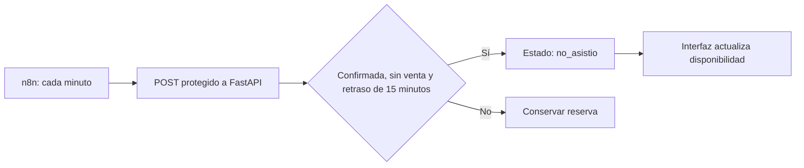

# Automatización de reservas con n8n

Se implementa el apartado de automatización del proyecto mediante Python/FastAPI y n8n. El proceso sustituye la revisión manual de clientes que no llegaron y mantiene el historial en PostgreSQL. No integra WhatsApp ni requiere servicios externos de mensajería.

## Regla y flujo



La hora se interpreta en America/Lima (UTC-5). Una reserva vence al cumplir 15 minutos; el planificador puede tardar hasta otro minuto en revisarla. El frontend consulta cada 15 segundos. Los reintentos no vuelven a modificar reservas ya procesadas. Las reservas con ventas se excluyen para proteger atenciones ya registradas.

El personal registra la llegada con **Registrar llegada** (`confirmada → ocupada`) y el fin del servicio con **Finalizar atención** (`ocupada → completada`). El cierre no genera una venta: se utiliza el módulo de ventas existente. La actualización condicional evita que una revisión concurrente sobrescriba un check-in.

## Configuración local

1. Preparar `backend/.env` siguiendo `backend/.env.example`, con conexión PostgreSQL y una clave aleatoria larga en `AUTOMATION_API_KEY`. No publicar esta clave. No requiere nuevas columnas ni migración para esta funcionalidad; utiliza el campo `estado` existente.
2. Iniciar Docker Desktop y ejecutar desde la raíz:

   ```powershell
   docker compose -f docker-compose.yml -f docker-compose.automation.yml up -d --build
   ```

3. Abrir http://localhost:5678 y crear la cuenta local de n8n.
4. Importar `automation/reservas-no-show.json` desde el menú de importación de workflows.
5. En **Liberar reservas vencidas**, crear una credencial **Header Auth**: nombre del encabezado `X-Automation-Key`, valor igual a `AUTOMATION_API_KEY`. Asignarla al nodo. La clave queda en las credenciales de n8n, fuera del JSON del repositorio.
6. Ejecutar manualmente para verificar la conexión y después guardar/publicar el workflow para habilitar la ejecución periódica. Se entrega inactivo para configurar la credencial antes de procesar datos.

El complemento Docker es para demostración local: puerto limitado a localhost, cookie HTTP local y almacenamiento persistente. Para publicarlo se requiere HTTPS y retirar `N8N_SECURE_COOKIE=false`. Si el backend corre fuera de Compose, adaptar la URL del nodo; `backend` es el nombre interno del servicio Docker.

## Evidencia para la entrega

En una base de datos de demostración, preparar reservas confirmadas con más de 15 minutos de retraso, una reciente y una con llegada registrada. Ejecutar el flujo y capturar:

- Diagrama de n8n y respuesta con `procesado_en`, `liberadas` y los identificadores.
- Reserva vencida en estado **No asistió** y disponibilidad liberada.
- Reserva ocupada y reserva reciente sin cambios.
- Segunda ejecución con cero nuevas liberaciones.

No ensayar con reservas reales antiguas: el proceso revisa todas las confirmadas vencidas, incluso de días anteriores. No se incorpora un endpoint para crear reservas pasadas: las pruebas automáticas generan los datos en SQLite aislado.

## Validación

```powershell
cd backend
python -m pytest tests/test_automation.py -v
```

Las pruebas cubren el límite de 15 minutos, UTC/Perú, días anteriores, estados protegidos, reservas con ventas, reintentos, transiciones y secreto ausente/incorrecto.

Verificación local: cinco pruebas del backend aprobadas con Python 3.14 y dependencias compatibles instaladas en `backend/.venv`; no sustituye la validación con las versiones fijadas en `requirements.txt` dentro de Docker/Python 3.12. La configuración Compose y el JSON se validaron, pero no se ejecutó n8n ni se consultó Supabase: faltan Docker en ejecución, `backend/.env` y la credencial del workflow.

Referencias oficiales: [Schedule Trigger](https://docs.n8n.io/integrations/builtin/core-nodes/n8n-nodes-base.scheduletrigger/), [Docker Compose](https://docs.n8n.io/hosting/installation/server-setups/docker-compose/).
